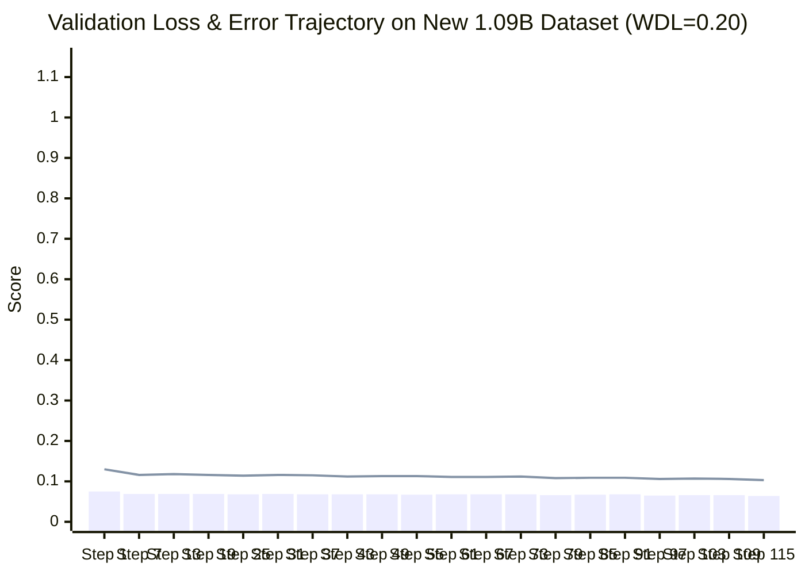

# KittyEngineTrainer

High-performance GPU-accelerated NNUE trainer for **KittyEngine**, powered by [Bullet](https://github.com/jw1912/bullet) and CUDA. Features a config-driven architecture, automated checkpoint evaluation across multi-pack streams, and standalone tournament playtest weight preservation.

---

## 🧠 Architecture & Specifications

| Property | Value |
| :--- | :--- |
| **Feature Transformer** | HalfKA Folded (`24,576` inputs: 32 king squares × 768 piece planes) |
| **Dual Accumulator** | `256` neurons per perspective (`512` combined) |
| **Hidden Layer 1** | `512 -> 32` (Dense + SCReLU) |
| **Hidden Layer 2** | `32 -> 32` (Dense + SCReLU) |
| **Output Layer** | `32 -> 1 x 8` Material Count Buckets |
| **Activation** | Squared Clipped ReLU (SCReLU: $\text{clamp}(x, 0, 1)^2$) |
| **Weight Clamping** | AdamW bounds strictly enforced at $[-1.98, +1.98]$ |
| **Evaluation Scale** | $400.0\text{ cp}$ centipawn evaluation scale |
| **Binary Weight Layout**| `NNUESGD6` format (exactly `25,237,864 bytes`) |

---

<!-- DASHBOARD_START -->
## 📈 Training Progress & Benchmark Dashboard

### Metric Trajectory (MAE & SMSE)


*(Bars: MAE | Line: SMSE)*

### Performance Metrics Table (Recent Steps)

| Step / Checkpoint | Epoch | Positions Trained | WDL | Overall MAE | Overall SMSE | MSE | Mate MAE | Non-Mate MAE | Status |
| :--- | :--- | :--- | :--- | :--- | :--- | :--- | :--- | :--- | :--- | :--- | :--- |
| **Step 115** | 13 | 27.96B | 0.20 | **0.0643478** | **0.1031227** | 0.0101516 | 0.0113673 | 0.0753024 | 👑 Promoted Champion |
| **Step 114** | 13 | 27.72B | 0.20 | **0.0655878** | **0.1048919** | 0.0103258 | 0.0132351 | 0.0764126 | Training Step |
| **Step 113** | 13 | 27.48B | 0.20 | **0.0654684** | **0.1041872** | 0.0102564 | 0.0131270 | 0.0762908 | Training Step |
| **Step 112** | 13 | 27.24B | 0.20 | **0.0655203** | **0.1054610** | 0.0103818 | 0.0119060 | 0.0766058 | Training Step |
| **Step 111** | 13 | 26.99B | 0.20 | **0.0655564** | **0.1053666** | 0.0103725 | 0.0121772 | 0.0765934 | Training Step |
| **Step 110** | 13 | 26.75B | 0.20 | **0.0656141** | **0.1060626** | 0.0104410 | 0.0128753 | 0.0765187 | Training Step |
| **Step 109** | 12 | 26.51B | 0.20 | **0.0660525** | **0.1058467** | 0.0104197 | 0.0136267 | 0.0768924 | Training Step |
| **Step 108** | 12 | 26.26B | 0.20 | **0.0657985** | **0.1058212** | 0.0104172 | 0.0133678 | 0.0766393 | Training Step |
| **Step 107** | 12 | 26.02B | 0.20 | **0.0654843** | **0.1059700** | 0.0104319 | 0.0118921 | 0.0765653 | Training Step |
| **Step 106** | 12 | 25.78B | 0.20 | **0.0650682** | **0.1044245** | 0.0102797 | 0.0118331 | 0.0760754 | 👑 Promoted Champion |
| **Step 105** | 12 | 25.53B | 0.20 | **0.0661286** | **0.1063035** | 0.0104647 | 0.0133575 | 0.0770398 | Training Step |
| **Step 104** | 12 | 25.29B | 0.20 | **0.0659329** | **0.1055270** | 0.0103883 | 0.0132367 | 0.0768286 | Training Step |
| **Step 103** | 12 | 25.05B | 0.20 | **0.0660240** | **0.1069157** | 0.0105250 | 0.0122174 | 0.0771494 | Training Step |
| **Step 102** | 12 | 24.80B | 0.20 | **0.0659045** | **0.1070322** | 0.0105365 | 0.0117391 | 0.0771041 | Training Step |
| **Step 101** | 12 | 24.56B | 0.20 | **0.0659746** | **0.1073798** | 0.0105707 | 0.0128916 | 0.0769504 | Training Step |

*(Displaying last 15 steps. Full historical log preserved in `checkpoints/training_history.json` or inspect via `cargo run --release -- status`)*
<!-- DASHBOARD_END -->

---

## ⚙️ Configuration (`config.yaml`)

All training hyperparameters, validation sizes, positive bias initializations, and checkpoint intervals are defined in `config.yaml`:

```yaml
# Total target superbatches for the training run
superbatches: 200

# WDL score distillation factor (0.0 = pure centipawns, 1.0 = pure WDL outcome)
wdl: 0.20

# Peak learning rate for Cosine Annealing decay
lr: 0.0025

# Minimum learning rate at cycle completion
min_lr: 0.0005

# Training batch size in positions (GTX 1660 Ti safe: 16384)
batch_size: 16384

# Validation positions evaluated per pack during checkpoint evaluation
eval_positions_per_pack: 2000000

# Periodic weight export interval
# Automatically exports and preserves 'checkpoints/weights_step_<N>.bin' every N superbatches
# Set to 1 to preserve every superbatch for standalone engine playtesting tournaments (SPRT)
save_interval: 1

# Positive Bias Initialization (Layer 0, Layer 1, Layer 2)
bias_l0: 0.05
bias_l1: 0.35
bias_l2: 0.35
```

---

## 🚀 Command Reference

The trainer uses a clean, single-word command interface:

### Core Workflows

- **Check Current Status & Metrics (<100ms)**
  ```bash
  cargo run --release -- status
  ```
  *Prints the active configuration, current baseline champion metrics, latest detected Bullet step, and recent training history without loading CUDA or datasets.*

- **Resume Training from Latest Checkpoint**
  ```bash
  cargo run --release -- resume
  ```
  *Automatically detects the highest completed step in `checkpoints/` (e.g. Step 115), sets the starting step to 116, preserves smooth Cosine Annealing, and trains up to `superbatches` in `config.yaml`.*

- **Start Fresh Training**
  ```bash
  cargo run --release -- train
  ```
  *Initializes fresh weights with positive biases (`0.05, 0.35, 0.35`), streams data from `data/`, runs evaluation every superbatch, and saves tournament checkpoints.*

- **Comprehensive Health Check**
  ```bash
  cargo run --release -- check [weights.bin]
  ```
  *Unified audit combining empirical Dead Neuron telemetry across all layers and high-centipawn polar sign disagreement detection. Defaults to `checkpoints/champion_weights.bin` across `data/`.*

- **Full Dataset Benchmark Evaluation**
  ```bash
  cargo run --release -- eval [weights.bin]
  ```
  *Evaluates overall MAE, overall SMSE, log-loss (BCE), MSE, RMSE, non-mate error, and mate accuracy across all packs in `data/`.*

- **Export Weights to KittyEngine Format**
  ```bash
  cargo run --release -- export [step_or_path] [output.bin]
  ```
  *Examples:*
  - `cargo run --release -- export` — Exports active champion to `weights.bin`.
  - `cargo run --release -- export 115` — Exports Step 115 checkpoint to `weights_step_115.bin`.
  - `cargo run --release -- export 115 my_engine_weights.bin` — Exports to custom path.

- **GPU vs CPU Mathematical Parity Check**
  ```bash
  cargo run --release -- compare [checkpoint_dir]
  ```
  *Validates that Bullet's GPU forward pass matches the CPU NNUE evaluation on standard benchmark positions.*

---

## 📁 Standardized Project Layout

Paths are permanently standardized to keep the workflow clean and simple:

```text
KittyEngineTrainer/
├── config.yaml          # Active training configuration & hyperparameters
├── data/                # Standardized training datasets (*.binpack)
├── checkpoints/         # Bullet checkpoints, active champion, & tournament weights
│   ├── champion_weights.bin
│   ├── baseline.json
│   ├── training_history.json
│   ├── kitty_bullet_screlu-115/
│   └── weights_step_*.bin
├── src/
│   ├── main.rs          # CLI entry point, training loop, scheduler, and commands
│   ├── config.rs        # Configuration loader, defaults, and checkpoint detection
│   ├── inputs.rs        # KittyHalfKA folded feature mapper (24,576 inputs)
│   ├── eval.rs          # Multi-threaded validation engine and metric computation
│   ├── export.rs        # Weight conversion between Bullet and NNUESGD6
│   ├── convert.rs       # JSON dataset to binary pack chunker
│   └── diagnostics.rs   # Layer-by-layer empirical dead neuron analyzer
├── Cargo.toml           # Dependencies (bullet_lib, CUDA, rayon, serde, serde_yaml)
└── README.md            # Project documentation & live dashboard
```
