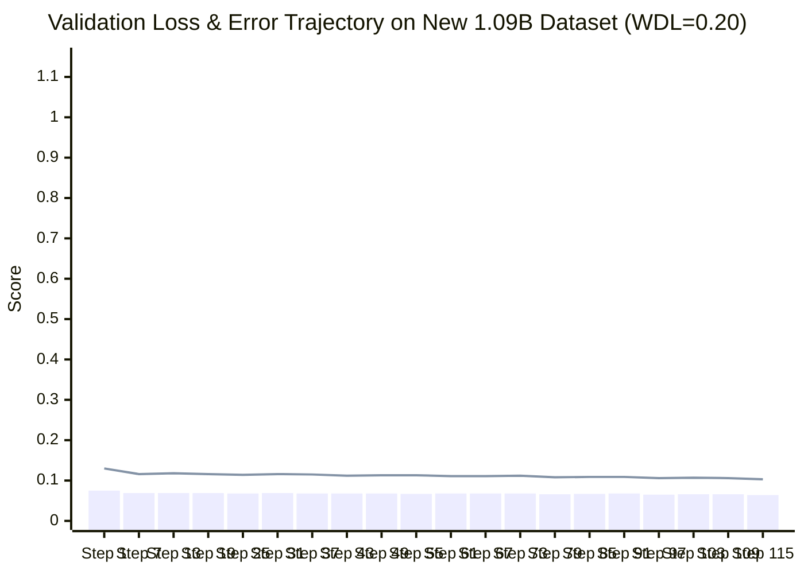

# KittyEngineTrainer

High-performance GPU-accelerated NNUE trainer for **KittyEngine**, powered by the [Bullet](https://github.com/jw1912/bullet) training library and CUDA.

---

## Architecture & Specifications

| Property | Value |
| :--- | :--- |
| **Feature Transformer** | HalfKA (`49,152` features: 64 king squares × 768 piece planes) |
| **Hidden Layers** | `(49152 -> 256) x 2 -> 32 -> 32 -> 1` |
| **Activation** | Squared Clipped ReLU (SCReLU: $\text{clamp}(x, 0, 1)^2$) |
| **Weight Clamping** | AdamW bounds strictly enforced at $[-1.98, +1.98]$ |
| **Output Scaling** | $400.0\text{ cp}$ centipawn evaluation scale |
| **Weight Format** | `NNUESGD5` binary layout (exactly `50,402,756 bytes`) |

---

<!-- DASHBOARD_START -->
## 📈 Training Progress & Benchmark Dashboard

### Metric Trajectory (MAE & SMSE)


*(Bars: MAE | Line: SMSE)*

### Performance Metrics Table

| Step / Checkpoint | Epoch | Positions Trained | WDL | Overall MAE | Overall SMSE | MSE | Mate MAE | Non-Mate MAE | Status |
| :--- | :--- | :--- | :--- | :--- | :--- | :--- | :--- | :--- | :--- | :--- |
| **Step 115** | 13 | 27.96B | 0.20 | **0.0643478** | **0.1031227** | 0.0101516 | 0.0113673 | 0.0753024 | 👑 Promoted Champion |
| **Step 114** | 13 | 27.72B | 0.20 | **0.0655878** | **0.1048919** | 0.0103258 | 0.0132351 | 0.0764126 | Training Step |
| **Step 113** | 13 | 27.48B | 0.20 | **0.0654684** | **0.1041872** | 0.0102564 | 0.0131270 | 0.0762908 | Training Step |
| **Step 112** | 13 | 27.24B | 0.20 | **0.0655203** | **0.1054610** | 0.0103818 | 0.0119060 | 0.0766058 | Training Step |
| **Step 111** | 13 | 26.99B | 0.20 | **0.0655564** | **0.1053666** | 0.0103725 | 0.0121772 | 0.0765934 | Training Step |
| **Step 110** | 13 | 26.75B | 0.20 | **0.0656141** | **0.1060626** | 0.0104410 | 0.0128753 | 0.0765187 | Training Step |
| **Step 109** | 12 | 26.51B | 0.20 | **0.0660525** | **0.1058467** | 0.0104197 | 0.0136267 | 0.0768924 | Training Step |
| **Step 108** | 12 | 26.26B | 0.20 | **0.0657985** | **0.1058212** | 0.0104172 | 0.0133678 | 0.0766393 | Training Step |
| **Step 107** | 12 | 26.02B | 0.20 | **0.0654843** | **0.1059700** | 0.0104319 | 0.0118921 | 0.0765653 | Training Step |
| **Step 106** | 12 | 25.78B | 0.20 | **0.0650682** | **0.1044245** | 0.0102797 | 0.0118331 | 0.0760754 | 👑 Promoted Champion |
| **Step 105** | 12 | 25.53B | 0.20 | **0.0661286** | **0.1063035** | 0.0104647 | 0.0133575 | 0.0770398 | Training Step |
| **Step 104** | 12 | 25.29B | 0.20 | **0.0659329** | **0.1055270** | 0.0103883 | 0.0132367 | 0.0768286 | Training Step |
| **Step 103** | 12 | 25.05B | 0.20 | **0.0660240** | **0.1069157** | 0.0105250 | 0.0122174 | 0.0771494 | Training Step |
| **Step 102** | 12 | 24.80B | 0.20 | **0.0659045** | **0.1070322** | 0.0105365 | 0.0117391 | 0.0771041 | Training Step |
| **Step 101** | 12 | 24.56B | 0.20 | **0.0659746** | **0.1073798** | 0.0105707 | 0.0128916 | 0.0769504 | Training Step |
| **Step 100** | 11 | 24.32B | 0.20 | **0.0667980** | **0.1074058** | 0.0105732 | 0.0135858 | 0.0778005 | Training Step |
| **Step 99** | 11 | 24.07B | 0.20 | **0.0663398** | **0.1073660** | 0.0105693 | 0.0133540 | 0.0772955 | Training Step |
| **Step 98** | 11 | 23.83B | 0.20 | **0.0659500** | **0.1073292** | 0.0105657 | 0.0121860 | 0.0770666 | Training Step |
| **Step 97** | 11 | 23.59B | 0.20 | **0.0654727** | **0.1056717** | 0.0104025 | 0.0117281 | 0.0765853 | 👑 Promoted Champion |
| **Step 96** | 11 | 23.34B | 0.20 | **0.0663256** | **0.1078650** | 0.0106184 | 0.0128125 | 0.0773902 | Training Step |
| **Step 95** | 11 | 23.10B | 0.20 | **0.0661445** | **0.1068742** | 0.0105209 | 0.0126798 | 0.0771991 | 👑 Promoted Champion |
| **Step 94** | 11 | 22.86B | 0.20 | **0.0665899** | **0.1083581** | 0.0106670 | 0.0131587 | 0.0776376 | Training Step |
| **Step 93** | 11 | 22.61B | 0.20 | **0.0659385** | **0.1077654** | 0.0106086 | 0.0123291 | 0.0770231 | Training Step |
| **Step 92** | 11 | 22.37B | 0.20 | **0.0666356** | **0.1083199** | 0.0106632 | 0.0127854 | 0.0777700 | Training Step |
| **Step 91** | 10 | 22.13B | 0.20 | **0.0675205** | **0.1090393** | 0.0107340 | 0.0142078 | 0.0785437 | Training Step |
| **Step 90** | 10 | 21.89B | 0.20 | **0.0664674** | **0.1086394** | 0.0106947 | 0.0126673 | 0.0775914 | Training Step |
| **Step 89** | 10 | 21.64B | 0.20 | **0.0662590** | **0.1086062** | 0.0106914 | 0.0121074 | 0.0774558 | Training Step |
| **Step 88** | 10 | 21.40B | 0.20 | **0.0660996** | **0.1069865** | 0.0105320 | 0.0121979 | 0.0772447 | 👑 Promoted Champion |
| **Step 87** | 10 | 21.16B | 0.20 | **0.0664941** | **0.1087464** | 0.0107052 | 0.0129390 | 0.0775674 | Training Step |
| **Step 86** | 10 | 20.91B | 0.20 | **0.0664719** | **0.1085008** | 0.0106810 | 0.0124292 | 0.0776461 | Training Step |
| **Step 85** | 10 | 20.67B | 0.20 | **0.0667561** | **0.1092813** | 0.0107579 | 0.0127569 | 0.0779213 | Training Step |
| **Step 84** | 10 | 20.43B | 0.20 | **0.0665493** | **0.1092142** | 0.0107513 | 0.0129823 | 0.0776252 | Training Step |
| **Step 83** | 10 | 20.18B | 0.20 | **0.0669809** | **0.1096802** | 0.0107971 | 0.0125021 | 0.0782452 | Training Step |
| **Step 82** | 9 | 19.94B | 0.20 | **0.0673189** | **0.1096585** | 0.0107950 | 0.0136750 | 0.0784106 | Training Step |
| **Step 81** | 9 | 19.70B | 0.20 | **0.0666994** | **0.1096518** | 0.0107943 | 0.0126800 | 0.0778688 | Training Step |
| **Step 80** | 9 | 19.45B | 0.20 | **0.0667557** | **0.1095825** | 0.0107875 | 0.0123574 | 0.0780034 | Training Step |
| **Step 79** | 9 | 19.21B | 0.20 | **0.0663873** | **0.1078260** | 0.0106146 | 0.0124923 | 0.0775310 | 👑 Promoted Champion |
| **Step 78** | 9 | 18.97B | 0.20 | **0.0667976** | **0.1101006** | 0.0108385 | 0.0128494 | 0.0779522 | Training Step |
| **Step 77** | 9 | 18.72B | 0.20 | **0.0673090** | **0.1100565** | 0.0108342 | 0.0136008 | 0.0784140 | Training Step |
| **Step 76** | 9 | 18.48B | 0.20 | **0.0674461** | **0.1109522** | 0.0109223 | 0.0127908 | 0.0787469 | Training Step |
| **Step 75** | 9 | 18.24B | 0.20 | **0.0666958** | **0.1098591** | 0.0108147 | 0.0124811 | 0.0779055 | Training Step |
| **Step 74** | 9 | 17.99B | 0.20 | **0.0672422** | **0.1107775** | 0.0109051 | 0.0128710 | 0.0784843 | Training Step |
| **Step 73** | 8 | 17.75B | 0.20 | **0.0676932** | **0.1116243** | 0.0109885 | 0.0128898 | 0.0790246 | Training Step |
| **Step 72** | 8 | 17.51B | 0.20 | **0.0671725** | **0.1108905** | 0.0109163 | 0.0131615 | 0.0783401 | Training Step |
| **Step 71** | 8 | 17.27B | 0.20 | **0.0672605** | **0.1106108** | 0.0108887 | 0.0130942 | 0.0784602 | Training Step |
| **Step 70** | 8 | 17.02B | 0.20 | **0.0667642** | **0.1089064** | 0.0107209 | 0.0129397 | 0.0778933 | 👑 Promoted Champion |
| **Step 69** | 8 | 16.78B | 0.20 | **0.0671111** | **0.1116392** | 0.0109900 | 0.0125435 | 0.0783939 | Training Step |
| **Step 68** | 8 | 16.54B | 0.20 | **0.0676101** | **0.1108698** | 0.0109142 | 0.0139200 | 0.0787113 | Training Step |
| **Step 67** | 8 | 16.29B | 0.20 | **0.0676312** | **0.1114092** | 0.0109673 | 0.0132633 | 0.0788726 | Training Step |
| **Step 66** | 8 | 16.05B | 0.20 | **0.0673244** | **0.1111760** | 0.0109444 | 0.0127765 | 0.0786031 | 👑 Promoted Champion |
| **Step 65** | 8 | 15.81B | 0.20 | **0.0673448** | **0.1119387** | 0.0110195 | 0.0129072 | 0.0786006 | Training Step |
| **Step 64** | 7 | 15.56B | 0.20 | **0.0673658** | **0.1115577** | 0.0109820 | 0.0132775 | 0.0785494 | Training Step |
| **Step 63** | 7 | 15.32B | 0.20 | **0.0676658** | **0.1117803** | 0.0110039 | 0.0137556 | 0.0788125 | Training Step |
| **Step 62** | 7 | 15.08B | 0.20 | **0.0676779** | **0.1121128** | 0.0110366 | 0.0133298 | 0.0789152 | Training Step |
| **Step 61** | 7 | 14.83B | 0.20 | **0.0678343** | **0.1106776** | 0.0108953 | 0.0141095 | 0.0789428 | 👑 Promoted Champion |
| **Step 60** | 7 | 14.59B | 0.20 | **0.0673272** | **0.1128507** | 0.0111092 | 0.0123422 | 0.0786962 | Training Step |
| **Step 59** | 7 | 14.35B | 0.20 | **0.0682091** | **0.1119304** | 0.0110186 | 0.0141587 | 0.0793848 | Training Step |
| **Step 58** | 7 | 14.10B | 0.20 | **0.0683193** | **0.1131900** | 0.0111426 | 0.0135402 | 0.0796457 | Training Step |
| **Step 57** | 7 | 13.86B | 0.20 | **0.0677260** | **0.1120144** | 0.0110269 | 0.0130046 | 0.0790406 | Training Step |
| **Step 56** | 7 | 13.62B | 0.20 | **0.0676567** | **0.1125401** | 0.0110787 | 0.0133236 | 0.0788909 | Training Step |
| **Step 55** | 6 | 13.37B | 0.20 | **0.0674167** | **0.1128152** | 0.0111057 | 0.0130728 | 0.0786531 | Training Step |
| **Step 54** | 6 | 13.13B | 0.20 | **0.0680415** | **0.1131612** | 0.0111398 | 0.0135411 | 0.0793104 | Training Step |
| **Step 53** | 6 | 12.89B | 0.20 | **0.0679103** | **0.1126208** | 0.0110866 | 0.0139174 | 0.0790741 | Training Step |
| **Step 52** | 6 | 12.64B | 0.20 | **0.0679265** | **0.1112841** | 0.0109550 | 0.0138750 | 0.0791025 | 👑 Promoted Champion |
| **Step 51** | 6 | 12.40B | 0.20 | **0.0683951** | **0.1142972** | 0.0112516 | 0.0145475 | 0.0795289 | Training Step |
| **Step 50** | 6 | 12.16B | 0.20 | **0.0684078** | **0.1124222** | 0.0110671 | 0.0138336 | 0.0796918 | Training Step |
| **Step 49** | 6 | 11.92B | 0.20 | **0.0683218** | **0.1131518** | 0.0111389 | 0.0137191 | 0.0796118 | Training Step |
| **Step 48** | 6 | 11.67B | 0.20 | **0.0682029** | **0.1131307** | 0.0111368 | 0.0132471 | 0.0795658 | Training Step |
| **Step 47** | 6 | 11.43B | 0.20 | **0.0690086** | **0.1145895** | 0.0112804 | 0.0145324 | 0.0802724 | Training Step |
| **Step 46** | 5 | 11.19B | 0.20 | **0.0678443** | **0.1140489** | 0.0112272 | 0.0129552 | 0.0791934 | Training Step |
| **Step 45** | 5 | 10.94B | 0.20 | **0.0681813** | **0.1134287** | 0.0111661 | 0.0138905 | 0.0794068 | Training Step |
| **Step 44** | 5 | 10.70B | 0.20 | **0.0682352** | **0.1134549** | 0.0111687 | 0.0140014 | 0.0794489 | Training Step |
| **Step 43** | 5 | 10.46B | 0.20 | **0.0679365** | **0.1121691** | 0.0110421 | 0.0132774 | 0.0792382 | 👑 Promoted Champion |
| **Step 42** | 5 | 10.21B | 0.20 | **0.0701178** | **0.1163842** | 0.0114571 | 0.0162643 | 0.0812528 | Training Step |
| **Step 41** | 5 | 9.97B | 0.20 | **0.0686494** | **0.1131570** | 0.0111394 | 0.0141060 | 0.0799270 | Training Step |
| **Step 40** | 5 | 9.73B | 0.20 | **0.0686453** | **0.1152175** | 0.0113422 | 0.0128929 | 0.0801730 | Training Step |
| **Step 39** | 5 | 9.48B | 0.20 | **0.0681376** | **0.1138587** | 0.0112085 | 0.0129882 | 0.0795407 | Training Step |
| **Step 38** | 5 | 9.24B | 0.20 | **0.0704056** | **0.1163925** | 0.0114579 | 0.0161074 | 0.0816326 | Training Step |
| **Step 37** | 4 | 9.00B | 0.20 | **0.0679961** | **0.1150236** | 0.0113231 | 0.0126794 | 0.0794336 | Training Step |
| **Step 36** | 4 | 8.75B | 0.20 | **0.0685196** | **0.1145569** | 0.0112772 | 0.0139374 | 0.0798054 | Training Step |
| **Step 35** | 4 | 8.51B | 0.20 | **0.0684106** | **0.1143429** | 0.0112561 | 0.0133924 | 0.0797865 | Training Step |
| **Step 34** | 4 | 8.27B | 0.20 | **0.0682274** | **0.1129677** | 0.0111208 | 0.0136704 | 0.0795080 | 👑 Promoted Champion |
| **Step 33** | 4 | 8.02B | 0.20 | **0.0697737** | **0.1152742** | 0.0113478 | 0.0152991 | 0.0810372 | Training Step |
| **Step 32** | 4 | 7.78B | 0.20 | **0.0696396** | **0.1142440** | 0.0112464 | 0.0165819 | 0.0806101 | Training Step |
| **Step 31** | 4 | 7.54B | 0.20 | **0.0685046** | **0.1155171** | 0.0113717 | 0.0127100 | 0.0800410 | Training Step |
| **Step 30** | 4 | 7.30B | 0.20 | **0.0681819** | **0.1147111** | 0.0112924 | 0.0121040 | 0.0797769 | Training Step |
| **Step 29** | 4 | 7.05B | 0.20 | **0.0697352** | **0.1158154** | 0.0114011 | 0.0147157 | 0.0811114 | Training Step |
| **Step 28** | 3 | 6.81B | 0.20 | **0.0680747** | **0.1148250** | 0.0113036 | 0.0128712 | 0.0794889 | Training Step |
| **Step 27** | 3 | 6.57B | 0.20 | **0.0691932** | **0.1151446** | 0.0113351 | 0.0146934 | 0.0804619 | Training Step |
| **Step 26** | 3 | 6.32B | 0.20 | **0.0685605** | **0.1152077** | 0.0113413 | 0.0127795 | 0.0800941 | Training Step |
| **Step 25** | 3 | 6.08B | 0.20 | **0.0684056** | **0.1136308** | 0.0111860 | 0.0137217 | 0.0797124 | 👑 Promoted Champion |
| **Step 24** | 3 | 5.84B | 0.20 | **0.0698102** | **0.1159972** | 0.0114190 | 0.0148511 | 0.0811739 | Training Step |
| **Step 23** | 3 | 5.59B | 0.20 | **0.0699192** | **0.1150776** | 0.0113285 | 0.0171704 | 0.0808259 | Training Step |
| **Step 22** | 3 | 5.35B | 0.20 | **0.0686089** | **0.1161601** | 0.0114350 | 0.0134633 | 0.0800111 | Training Step |
| **Step 21** | 3 | 5.11B | 0.20 | **0.0681720** | **0.1156901** | 0.0113888 | 0.0126019 | 0.0796619 | 👑 Promoted Champion |
| **Step 20** | 3 | 4.86B | 0.20 | **0.0700985** | **0.1171263** | 0.0115301 | 0.0140986 | 0.0816773 | Training Step |
| **Step 19** | 2 | 4.62B | 0.20 | **0.0692914** | **0.1160064** | 0.0114199 | 0.0151603 | 0.0804839 | Training Step |
| **Step 18** | 2 | 4.38B | 0.20 | **0.0707314** | **0.1171422** | 0.0115317 | 0.0165217 | 0.0819401 | Training Step |
| **Step 17** | 2 | 4.13B | 0.20 | **0.0688066** | **0.1160680** | 0.0114260 | 0.0130179 | 0.0803418 | Training Step |
| **Step 16** | 2 | 3.89B | 0.20 | **0.0690190** | **0.1143388** | 0.0112557 | 0.0146555 | 0.0802595 | 👑 Promoted Champion |
| **Step 15** | 2 | 3.65B | 0.20 | **0.0695339** | **0.1167314** | 0.0114913 | 0.0148960 | 0.0808312 | Training Step |
| **Step 14** | 2 | 3.40B | 0.20 | **0.0699016** | **0.1158638** | 0.0114059 | 0.0161447 | 0.0810166 | Training Step |
| **Step 13** | 2 | 3.16B | 0.20 | **0.0693658** | **0.1175654** | 0.0115734 | 0.0145779 | 0.0806941 | Training Step |
| **Step 12** | 2 | 2.92B | 0.20 | **0.0685798** | **0.1168257** | 0.0115005 | 0.0127353 | 0.0801265 | 👑 Promoted Champion |
| **Step 11** | 2 | 2.67B | 0.20 | **0.0699069** | **0.1172635** | 0.0115436 | 0.0145832 | 0.0813460 | Training Step |
| **Step 10** | 1 | 2.43B | 0.20 | **0.0704580** | **0.1175426** | 0.0115711 | 0.0162853 | 0.0816590 | Training Step |
| **Step 9** | 1 | 2.19B | 0.20 | **0.0715280** | **0.1190361** | 0.0117181 | 0.0172621 | 0.0827483 | Training Step |
| **Step 8** | 1 | 1.95B | 0.20 | **0.0699913** | **0.1181989** | 0.0116357 | 0.0145045 | 0.0814641 | Training Step |
| **Step 7** | 1 | 1.70B | 0.20 | **0.0694551** | **0.1162291** | 0.0114418 | 0.0141988 | 0.0808802 | 👑 Promoted Champion |
| **Step 6** | 1 | 1.46B | 0.20 | **0.0698835** | **0.1188449** | 0.0116993 | 0.0149240 | 0.0812473 | 👑 Promoted Champion |
| **Step 5** | 1 | 1.22B | 0.20 | **0.0702639** | **0.1184877** | 0.0116642 | 0.0157975 | 0.0815257 | 👑 Promoted Champion |
| **Step 4** | 1 | 972.7M | 0.20 | **0.0701471** | **0.1210855** | 0.0119199 | 0.0127049 | 0.0820242 | 👑 Promoted Champion |
| **Step 3** | 1 | 729.5M | 0.20 | **0.0706454** | **0.1221112** | 0.0120209 | 0.0135579 | 0.0824492 | 👑 Promoted Champion |
| **Step 2** | 1 | 486.3M | 0.20 | **0.0714251** | **0.1236754** | 0.0121748 | 0.0147553 | 0.0831425 | 👑 Promoted Champion |
| **Step 1** | 1 | 243.2M | 0.20 | **0.0747747** | **0.1299010** | 0.0127877 | 0.0183567 | 0.0864400 | 👑 Promoted Champion |
<!-- DASHBOARD_END -->

---

## Prerequisites

- **Rust**: 1.80+ (2024 edition)
- **NVIDIA GPU**: CUDA 12+ runtime and drivers
- **C++ Compiler**: MSVC (Windows) or GCC/Clang (Linux)

---

## Quickstart Tutorial

### 1. Preparing Training Data
Convert raw JSON engine evaluation logs into memory-mapped binary chunks:
```bash
cargo run --release -- pack-chunks <path/to/eval.json> data/ 50000000
```

### 2. Training the Model
Train across multi-pack interleaved streams with cosine learning rate scheduling and automatic validation after every superbatch:

**Start from an existing checkpoint:**
```bash
cargo run --release -- train data/ --weights checkpoints/kitty_bullet_screlu-609 --start-superbatch 610 --superbatches 640 --lr 0.000015 --wdl 0.20
```

**Train from scratch:**
```bash
cargo run --release -- train data/ --superbatches 36 --lr 0.0025 --wdl 0.20
```

### 3. Evaluating Weights
Stream full validation across all dataset packs to measure MAE, SMSE, BCE, and mating accuracy:
```bash
cargo run --release -- eval checkpoints/weights_screlu_step609.bin data/ 2000000
```

### 4. Exporting & Importing Checkpoints
Convert Bullet's GPU `raw.bin` directly into KittyEngine's binary weight format:
```bash
cargo run --release -- export checkpoints/kitty_bullet_screlu-609/raw.bin weights.bin
```

Convert a KittyEngine `weights.bin` back into Bullet format for fine-tuning:
```bash
cargo run --release -- import weights.bin checkpoints/init_bullet_weights.bin
```

### 5. Diagnostics & Quality Audits
- **Dead Neuron Detection**: Check activation telemetry across all layers to ensure gradient flow:
  ```bash
  cargo run --release -- dead-neurons weights.bin data/ 1000000
  ```
- **Inversion Scan**: Detect high centipawn evaluation sign disagreements against ground truth:
  ```bash
  cargo run --release -- inversions weights.bin data/ 1000000
  ```
- **Parity Check**: Validate numerical parity between GPU Bullet and CPU NNUE evaluations:
  ```bash
  cargo run --release -- compare checkpoints/kitty_bullet_screlu-609
  ```

---

## Project Structure

```text
KittyEngineTrainer/
├── src/
│   ├── main.rs         # CLI entry point, training loop, scheduler, and commands
│   ├── inputs.rs       # KittyEngine HalfKA feature mapper (49,152 inputs)
│   ├── eval.rs         # Multi-threaded validation engine and metric computation
│   ├── export.rs       # Checkpoint conversion between Bullet and NNUESGD5
│   ├── convert.rs      # JSON evaluation log to binary pack chunker
│   └── diagnostics.rs  # Layer-by-layer neuron activation and dead neuron analyzer
├── Cargo.toml          # Dependencies (bullet_lib with CUDA, rayon, serde)
└── README.md           # Documentation
```
